# Valheim: Deep Waters

A fishing overhaul for Valheim. Fish swim up to your bait, nibble, and then bite, just like vanilla, but now you play the fight with
line tension, drag, and stamina. There are rods for every era, a tackle screen with reels, lines, floats, hooks and
weights, bait you gather from the world, spear fishing, buffs, trophies, and a catch log.

Requires BepInEx 5 and Jötunn 2.30 or newer. Built for Valheim 1.0.20.

Full guide, one page per topic: the [Deep Waters wiki](https://github.com/trippydatruth/ValheimDeepWaters/wiki).

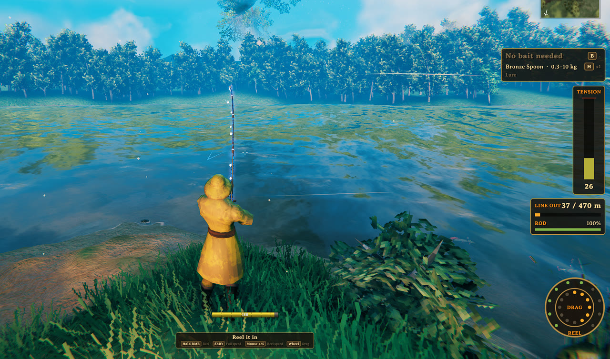

## Features

- All 12 vanilla fish plus 34 new ones, including 11 legendaries, each with its own biomes, depth,
  favourite bait, time of day and weather
- Fish you can see swim up to your bait, nibble the float, then bite. Strike too early and you spook them;
  make noise and they flee
- A real fight: line tension, drag on the mouse wheel, sideways runs, leaps and snapped lines
- Thirteen rods, one for each era plus special ones, that wear out with use and upgrade to level 4
- A tackle screen beside the inventory with the whole rod pictured and eight slots - rod, reel, line, float, hook,
  bait or lure, weight and leader - and three loadouts you can swap between; the rod in its slot takes no space
- Reels, lines and floats for every era, and hooks in six sizes and four kinds: J, circle (sets itself), EWG
  (holds big fish) and treble (soft baits, on the bottom)
- Bait from the world: worms, grubs, flies, leeches and baitfish, and baits you make, each with its own model
- Weights and leaders: every fish feeds at its own depth, so set your leader to fish the depth you want, or fish the
  bottom with a weight, a Texas rig or a Carolina rig. Light weights get dragged about by waves and storms
- Tackle boxes in seven tiers (four crafted, three from Hildir): carry your tackle in your hand, open it anywhere, set it down as a chest
- Coolers in three tiers that keep your catch fresh: fresh fish sell for more and clean into more
- Lures you cast far and retrieve (spoons, spinners, crankbaits, jigs, soft baits, swimbaits, poppers and flies),
  with trailers, and seven boss lures
- Spear fishing: stab or throw a spear at fish near the surface, with eight leisters (fish spears) made for it
- Ice fishing: drill a hole in the Deep North's frozen lakes with the Ice Auger and fish down it with the Ice Fishing
  Rod, for three fish that live only under the ice. Fish from three shelters you walk into: a hide lavvu, an igloo
  with an ice bench and a deer hide to sit on, and a Viking ship-tent with its own campfire
- Rod holders that keep a line fishing while you do something else, and rod racks to store your rods
- A Fishing Boat you row, with a passenger seat and a bow holdfast
- Fishing meads (from mead bases, like vanilla's), chum, totems, rare relics, a Fisherman's armour set and two angler caps
- Seven boss fish you summon with boss lures, each with its own weather, music and fight
- Angler ranks, species mastery with Gold Trophy Plaques, and rare golden and albino catches
- A Fish Cleaning Table, fish materials, dishes and feasts, and traders who each buy their own catch
- An endgame: the Allfather's Rod and Njord's Regalia, earned by landing every boss fish
- Size classes, a trophy mount, cooking, selling, a catch log with rewards, and Valheim's Fishing skill
- In multiplayer, players nearby see your line, the fish you're fighting and the catch

## How to fish

1. Craft a **Wooden Fishing Rod** (workbench) and some **Tiny hooks**, and dig up worms from wriggling soil
   in the forest.
2. Put the rod, bait and a hook in your **tackle screen** beside the inventory (or right-click them there).
3. Face the water, **hold left click** to charge, and release to cast. A quick tap drops the bait just in front
   of you, handy for fish you can see.
4. Fish come to the bait and **nibble** the float with small dips. Don't strike yet.
5. On the real bite (**FISH ON!**, a big dip), **right click** to set the hook.
6. **Hold right click** to reel and use the **mouse wheel** to set the drag. Tighter drag reels faster and
   tires the fish quicker, but risks snapping the line. Reeling costs stamina.

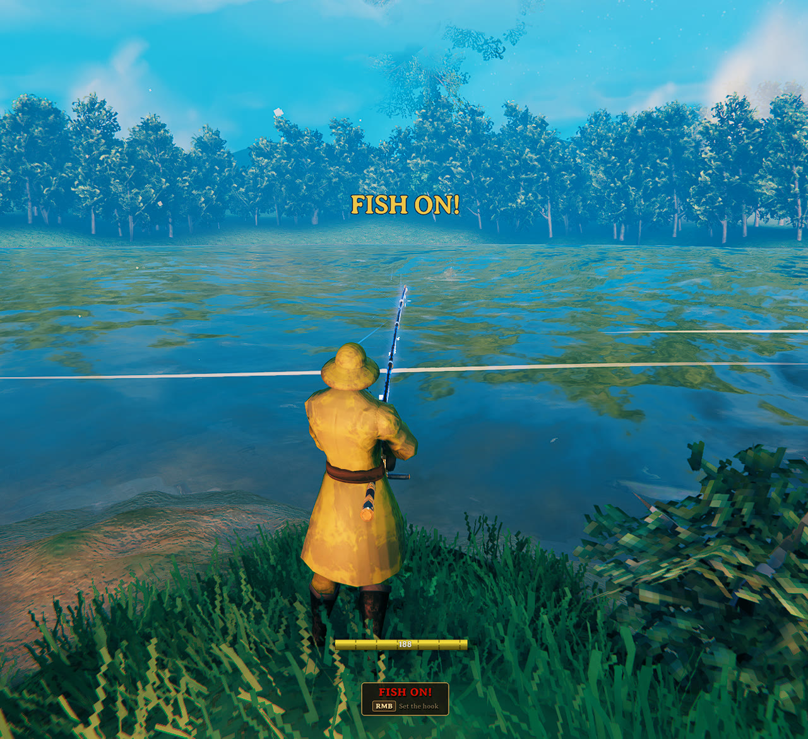

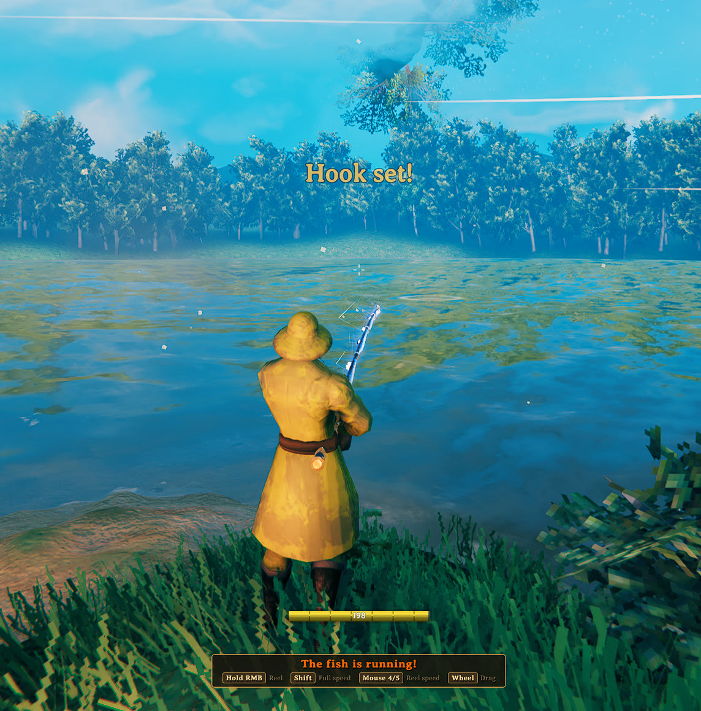

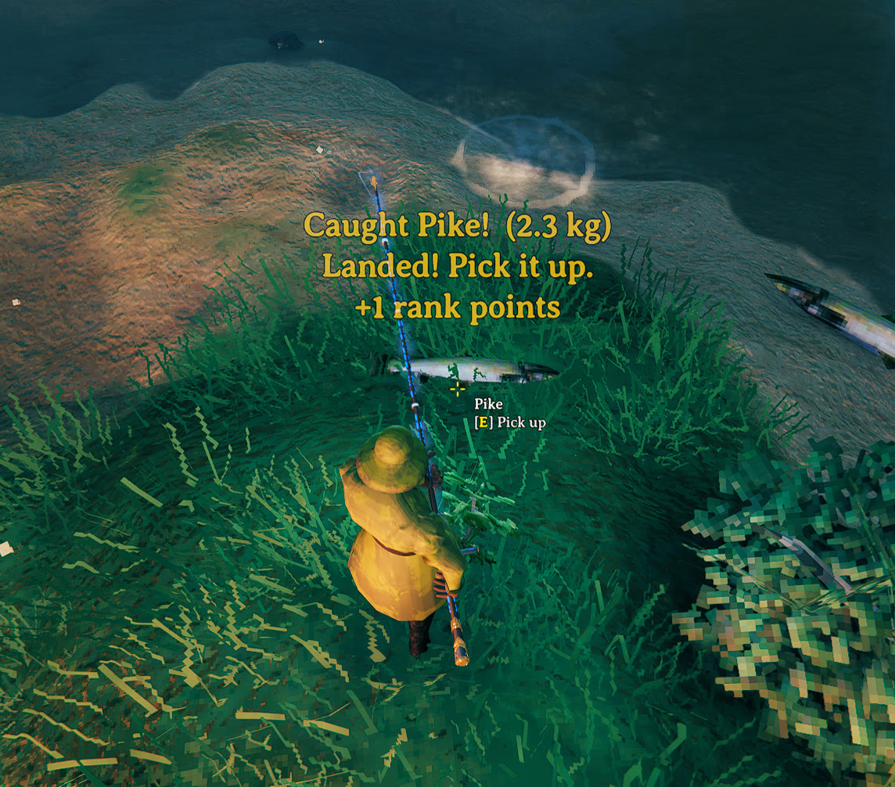

Bait is only used up once a fish is hooked.

| Action | Input |
|---|---|
| Cast | Hold and release left click |
| Set the hook | Right click on the bite |
| Reel in early | Right click while waiting |
| Reel | Hold right click |
| Drag | Mouse wheel (configurable) |
| Reel speed | Alt + mouse wheel (configurable; Shift: full speed) |
| Twitch a lure | Left click while retrieving |
| Pull back on a fish | Hold left click |
| Next bait / next hook | `B` / `H` |
| Catch log | `J` |

## Rods

Each rod is better than the last. Every rod lists its stats in its tooltip: cast distance, line, line
strength, reel speed, power, hook bonus, stamina use and durability.

| Rod | Station | Materials |
|---|---|---|
| Wooden | Workbench 1 | Wood 10, Leather scraps 4 |
| Copper | Forge 1 | Wood 6, Copper 5, Deer hide 2 |
| Finewood | Forge 2 | Fine wood 10, Bronze 4, Troll hide 2 |
| Ancient Bark | Forge 2 | Ancient bark 10, Iron 4, Guck 3 |
| Silver | Forge 3 | Fine wood 6, Silver 6, Wolf pelt 2 |
| Black Metal | Forge 5 | Fine wood 6, Black metal 6, Linen thread 6 |
| Yggdrasil | Black forge 1 | Yggdrasil wood 10, Carapace 4, Eitr 2 |
| Ashwood | Black forge 2 | Blackwood 10, Flametal 4, Asksvin hide 2 |
| Frostwood | Black forge 3 | Timberwood 10, Frostcore 3, Moose sinew 4 |
| Leviathan | Black forge 2 | Two materials from each of the seven boss fish, Yggdrasil wood 10, Flametal 6 |
| Allfather's Rod | Black forge 3 | The Leviathan Rod and three materials from each boss fish; shows once you've landed every boss fish |
| Haldor's Gilded Rod | Haldor only | 6000 coins |
| Ice Fishing Rod | Forge 3 | Fine wood 4, Gold 2, Elaking hair bundle 3 (see [Ice fishing](#ice-fishing)) |

Rods wear while a fish is on the line, faster with heavy fish and high tension. A broken rod loses the fish
and must be repaired where it was crafted.

### Upgrading rods

Every rod upgrades to level 4 at its crafting station, like vanilla gear. Each level adds cast distance, line,
line strength, reel speed, power, hook bonus and durability, and eases reeling stamina; a fully upgraded rod sits
about halfway to the next one. Upgrades cost fish materials (see below), the line of the rod's era (leather
scraps, deer hide, linen, jute, morgen sinew, moose sinew) and some of each biome's oddments: greydwarf eyes,
obsidian, tar, deathsquito needles, sap, charred bone, celestial feathers. The last level also needs a
**Trophy Fin**. The tooltip shows the rod's stats at its level.

## Fish materials

Clean a catch at the **Fish Cleaning Table** for its material. Bigger fish give more: a Trophy-size fish gives four
times what a Small one does. The table (hammer, near a workbench: 10 wood, 4 flint, 4 resin) cleans the common fish;
its three add-ons, built beside it, let it handle the rarer ones:

| Level | Add-on | Cleans for | Prepares | Cost |
|---|---|---|---|---|
| 1 | Fish Cleaning Table | Fish Scales, Fish Oil | | 10 wood, 4 flint, 4 resin |
| 2 | Filleting Knife Rack | Spiny Fins, Fish Roe | Fish Fillets (from any fish) | 4 fine wood, 2 bronze, 10 Fish Scales |
| 3 | Brining Barrel | Abyssal Ink, Legendary Scales | Brined Roe (3 roe, 1 oil) | 6 fine wood, 2 iron, 10 Fish Oil |
| 4 | Drying Line | Cinder Scales, Rime Scales | Dried Fish (3 fillets) | 6 fine wood, 3 red jute, 10 Abyssal Ink |

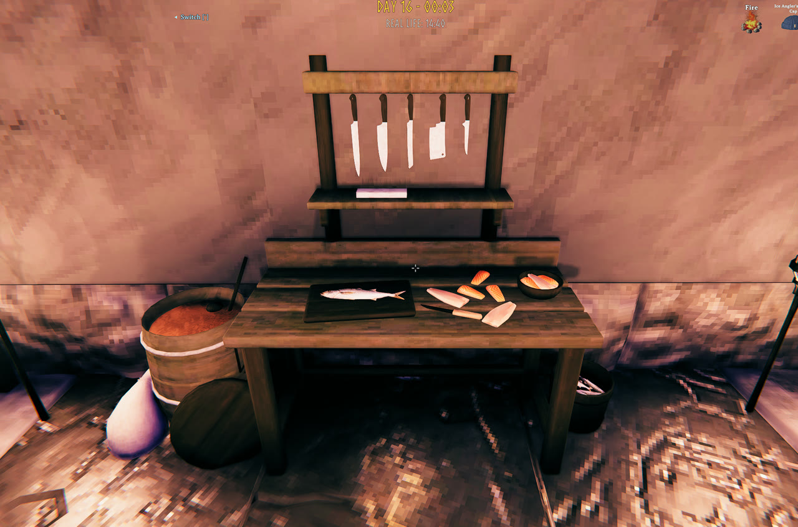

Cleaning fish raises your Fishing skill.

The materials go into rod upgrades, every lure (the boss lures take three of their biome's material), the crafted
baits, the meads, chum, the Rune of Njord and the totems.

### Fish dishes

Made from the cleaning table's prepared ingredients at Valheim's own food stations:

| Dish | Where | Ingredients | Health / Stamina / Eitr |
|---|---|---|---|
| Grilled Fish Fillet | Cooking station | A Fish Fillet | 25 / 22 |
| Fisherman's Stew | Cauldron 1 | Fish Fillets, Fish Oil, 2 carrots | 35 / 40 |
| Spiny Fin Soup | Cauldron 2 | Fish Fillets, 2 Spiny Fins, 2 onions | 50 / 45 |
| Roe Flatbread | Cauldron 3 | Bread, 2 Brined Roe, 2 cloudberries | 40 / 75 |
| Ink-Black Noodles | Cauldron 4 | Fish Fillets, Abyssal Ink, 2 jotun puffs | 45 / 30 / 75 |
| Ember-Grilled Fillet | Cauldron 5 | 2 Fish Fillets, Cinder Scales, 2 vineberries | 85 / 50 |
| Rime-Cured Salmon | Food preparation table | 2 Fish Fillets, Rime Scales, 2 lingonberries | 80 / 70 / 30 |
| Fisherman's Rations | Food preparation table | 2 Dried Fish, 2 cloudberries, honey | 35 / 35, lasts an hour |

| Material | From |
|---|---|
| Fish Scales | Perch, Bluegill, Trout, Largemouth Bass, Greydwarf Goby, Pike |
| Fish Oil | Trollfish, Channel Catfish, Mackerel, Sea Bass, Giant Herring, Surtling Sardine |
| Spiny Fins | Tetra, Frost Char, Coral Cod, Pufferfish, Serpentfin, Lake Whitefish |
| Fish Roe | Tuna, Grouper, Halibut, Lingcod |
| Abyssal Ink | Anglerfish, Mistfin, Bonemaw, Jotunn Perch |
| Cinder Scales | Magmafish |
| Rime Scales | Northern Salmon, Rimejaw Cod, Glacier Grayling, Frost Sculpin, Burbot |
| Legendary Scale | Any legendary or boss fish |

Landing a **Trophy-size** fish of any kind also gives a **Trophy Fin**.

## Hooks

You need a hook to cast, and each size suits a range of fish weights.

| Hook | Suits | Station | Recipe (makes) |
|---|---|---|---|
| Tiny #12 | 0–1.5 kg | Workbench 1 | Flint 1, Resin 1 (5) |
| Small #6 | 0.5–5 kg | Forge 1 | Copper 1 (5) |
| Medium #2 | 2–15 kg | Forge 1 | Bronze 1 (5) |
| Large 2/0 | 8–40 kg | Forge 2 | Iron 1 (4) |
| Heavy 5/0 | 25–100 kg | Forge 3 | Iron 1, Silver 1 (3) |
| Giant 8/0 | 60–250 kg | Forge 5 | Black metal 2 (3) |
| Fimbul 12/0 | 25–300 kg, never bends, kept half the time the line breaks | Forge 5 | Rimefrost Fin 1, Silver 2 (1) |
| Golden 10/0 | Any fish (0–300 kg), never bends, kept three times in four when the line breaks, +5% hook chance and +15% hook window | Can't be crafted | A relic: very rarely inside a legendary fish |

- **Too big for the fish:** much harder to hook.
- **Too small:** a big fish can straighten it mid-fight, and a fish far too big won't bite at all.

You lose the hook if the line snaps, the rod breaks or the hook straightens.

**Hook kinds.** The hooks above are J hooks, the all-rounder. From Small to Giant each size also comes as a circle,
EWG or treble hook, made from the same metal (trebles make a few fewer). Each fishes in its own way, and the tooltip
says how:

| Kind | Made for | How it fishes |
|---|---|---|
| J | Anything | Set it yourself when the fish bites |
| Circle | Live and cut bait | Three times as long to strike, and left alone it sets itself; head shakes pull half as hard. Strike the instant it bites and it can pull free |
| EWG | Worms and soft baits | Straightens half as easily, holds through head shakes, hooks better with worms, grubs and leeches |
| Treble | Soft, stinky baits on the bottom | Hooks better, more on a weighted rig and with soft baits (stinkbait, cut bait, blubber, shrimp); bends out sooner on fish too heavy for it |

## Vanilla fish

All 12 vanilla fish can be caught with Deep Waters rods: Perch, Pike, Tuna, Tetra, Trollfish, Giant Herring,
Grouper, Coral Cod, Pufferfish, Anglerfish, Northern Salmon and Magmafish. They live where vanilla spawns
them, and landing one gives the normal vanilla item, so vanilla cooking, recipes and food all work. They
also get a weight and size class, plus any extra drops vanilla gives. They bite Deep Waters bait like every other
fish. The vanilla fishing rod and vanilla fishing baits are taken out of the game: no one sells them and
they can't be crafted.

## Deep Waters fish

31 new fish to catch and eat, plus 3 bait fish. Weights are each species' maximum. Ocean and deep-ocean fish
bite in any sea; fresh-water fish only in their biomes.

**Fresh water**

| Fish | Water | Biomes | Max |
|---|---|---|---|
| Bluegill | Lake | Meadows | 0.6 kg |
| Greydwarf Goby | Lake | Black Forest | 1.5 kg |
| Trout | River | Meadows, Black Forest, Mountain | 4 kg |
| Largemouth Bass | Lake | Meadows, Black Forest | 5 kg |
| Frost Char | Lake | Mountain, Deep North | 6 kg |
| Mistfin | Lake | Swamp, Mistlands | 12 kg |
| Channel Catfish | Lake, river | Black Forest, Swamp | 20 kg |
| Glacier Grayling | River | Deep North | 3 kg |
| Frost Sculpin | Lake | Deep North | 4 kg |

**Under the ice** (bite only through a hole in the ice; see [Ice fishing](#ice-fishing))

| Fish | Biomes | Max |
|---|---|---|
| Lake Whitefish | Mountain, Deep North | 5 kg |
| Burbot (at night, on the bottom) | Mountain, Deep North | 8 kg |
| Ice King Trout (legendary) | Deep North | 40 kg |

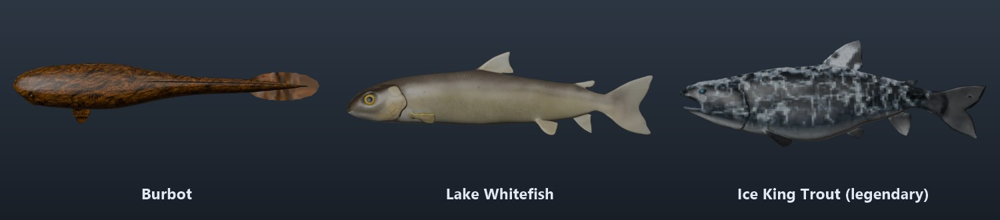

**Ocean**

| Fish | Max |
|---|---|
| Surtling Sardine | 2 kg |
| Mackerel | 3 kg |
| Sea Bass | 9 kg |
| Serpentfin | 28 kg |
| Rimejaw Cod (Deep North coasts and deep lakes) | 18 kg |

**Deep ocean** (15 m of water or more)

| Fish | Max |
|---|---|
| Lingcod | 25 kg |
| Halibut | 45 kg |
| Jotunn Perch | 55 kg |
| Bonemaw | 70 kg |

**Legendary** (rare, and they fight hard)

| Fish | Water | Max |
|---|---|---|
| Eikthyr Elver | Meadows river | 12 kg |
| Elder Bass | Black Forest lake | 60 kg |
| Bonemass Catfish | Swamp lake | 85 kg |
| Fenringfin | Ocean | 35 kg |
| Thor's Hammerhead | Ocean | 140 kg |
| Odin's Eye | Deep ocean | 25 kg |
| Queen Eel | Deep ocean | 50 kg |
| Yagluth Gill | Deep ocean | 100 kg |
| Moder Scale Fish | Deep ocean | 180 kg |
| Fimbul Salmon | Deep North river | 250 kg |
| Ice King Trout | Deep North lake, under the ice | 40 kg |

**Bait fish** (land as bait instead of food; use a Tiny hook)

| Fish | Water | Gives |
|---|---|---|
| Minnow | River | Live Minnow |
| Baitfish | Any | Large Live Baitfish |
| Sea Shrimp | Ocean | Shrimp Bait |

## Boss fish

Seven legendaries are named after Valheim's bosses, and they're boss fights. They never bite by chance: you
summon one with a **lure** carved from that boss's trophy (or, for Kall Fimbulbringer, his Crown Jewel), cast in the
right water at the right time.

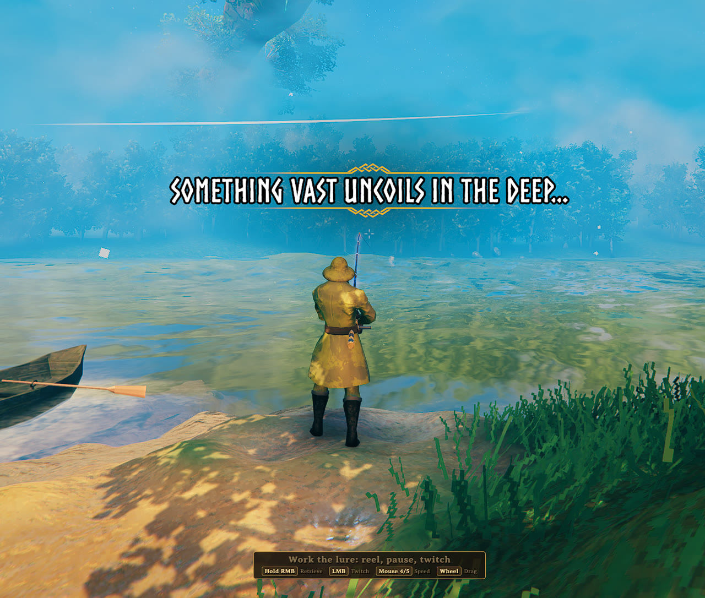

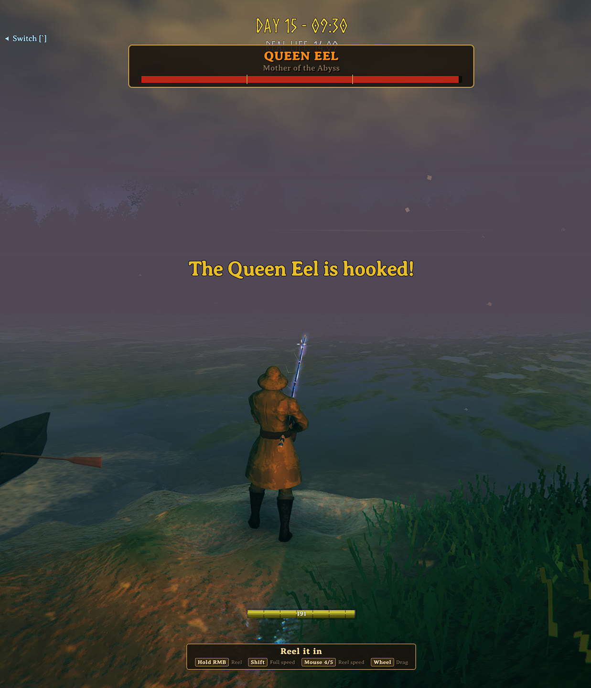

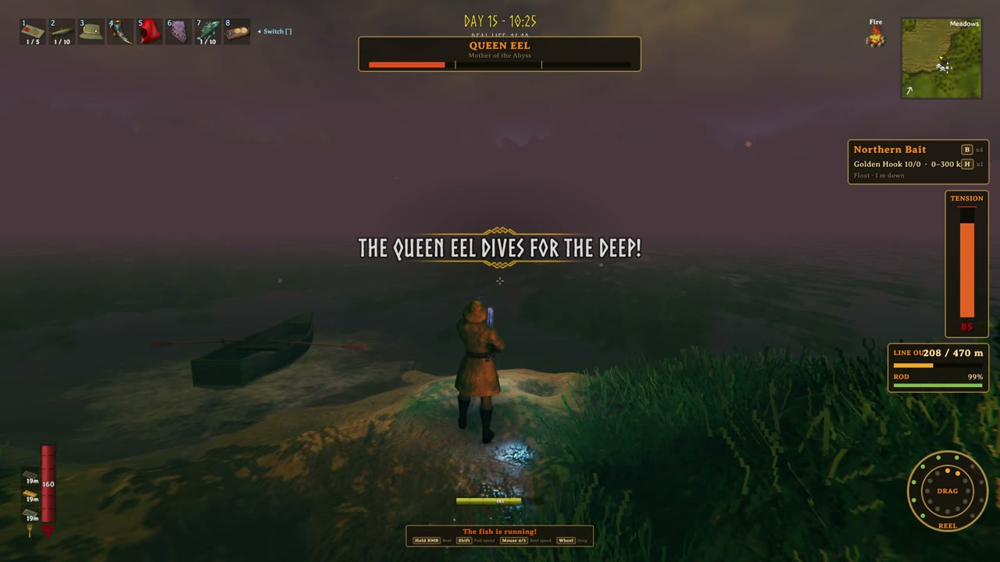

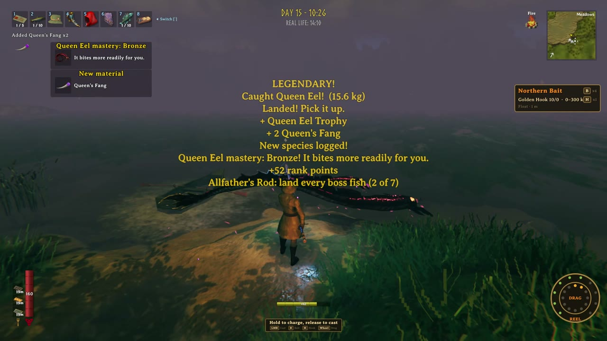

| Boss fish | Lure | Where | When |
|---|---|---|---|
| Eikthyr Elver | Antler Lure (Eikthyr trophy) | Meadows river | Thunderstorm |
| Elder Bass | Root Lure (The Elder trophy) | Black Forest lake | Night |
| Bonemass Catfish | Ooze Lure (Bonemass trophy) | Swamp water | Rain |
| Moder Scale Fish | Wyrm Lure (Moder trophy) | Sea off the Deep North | Storm or snow |
| Yagluth Gill | Ember Lure (Yagluth trophy) | Deep sea off the Plains | Night |
| Queen Eel | Chitin Lure (The Queen trophy) | Deep sea off the Mistlands | Any time |
| Fimbul Salmon | Crown Lure (Kall Fimbulbringer's Crown Jewel, black forge) | Deep North river or lake | Night |

Cast the lure in the right place and an **omen** begins: the water goes still, a dark swirl spreads around the
float, a sign appears, bubbles rise and the float shudders - then it strikes. You get twice the usual time to
set the hook. Reeling in during the omen calls it off and keeps the lure; it's only used up once the fish is
hooked. In the wrong place nothing answers, and you're told where it hunts.

From the omen to the end of the fight the boss brings **its namesake boss's weather** - Eikthyr's storm, the
Elder's mist, Bonemass's rot, Moder's blizzard, Yagluth's embers, the Queen's gloom. Everyone within about 150 m
sees it and hears the boss music, so friends can come and watch.

The **Queen Eel** fights like a sea serpent: a 7.5 m monster that circles you, its back humping through the waves;
once enraged it charges straight at you - reel hard to keep the line tight - and rears out of the water before
crashing down. Pull back while it's reared up: that's when it tires fastest.

The fight brings up a **boss bar** with its name - its stamina, which drains faster the harder you fight it
(tight drag, high tension) and recovers if you give it slack, so no two fights are alike. It plays its boss's
**music** and goes through **phases**: at two thirds it's enraged (pulls harder, leaps more), at one third
desperate (dives that tear line off the reel). An empty bar means it's beaten; then reel it in. Landing one
drops its **trophy** the first time and a **boss material** every time, and tells the whole server. Two materials
from each of the seven string the **Leviathan Rod** (black forge).

**The endgame:**
- **Boss lures cost more each time** you land their boss: every ingredient but the boss part needs one more per
  landing, up to three times the first cost, and the Bog Witch's price rises the same way. It's per character.
- **Allfather's Rod:** once you've landed every boss fish, remake the Leviathan Rod with three materials from each -
  the best rod there is.
- **Njord's Regalia:** once you've landed every boss fish three times, set the Pearl, the Scale, the Horn and the
  Golden Hook in one crown (they're used up), with two materials from each boss: every relic's blessing in one helm.
- The catch log's sidebar shows how many boss fish you've landed and what the next unlock needs.

Fenringfin, Thor's Hammerhead and Odin's Eye are **mini-bosses**: they still bite by luck and fight the same
way (phases and all), with no bar, music or messages, and drop their trophy the first time.

## Bait

| Bait | Where to get it |
|---|---|
| Worms | Dig up **wriggling soil** in forests where red mushrooms grow (it regrows), usually 1 worm and sometimes 2 or 3. When it rains, worms come up out of the ground around you |
| Grubs | Sometimes found when you chop up a log |
| Flies | Swarms along rivers, lakes and the coast in dry weather (fireflies at night); walk up and use one to catch it |
| Leeches | Dropped by swamp leeches |
| Minnows, Large Baitfish, Shrimp, Live Bluegill | Catch them as small fish with worms, grubs or flies on a Tiny hook; they swim in schools where they live (bluegill in Meadows lakes, on worms and grubs) |
| Abyssal and Frost bait | Crafted at the cauldron |
| Northern Bait | Crafted at the cauldron (seal blubber and lingonberries); the Deep North's fish want it |
| Cut Bait | Cut at the Fish Cleaning Table from any one Live Minnow, Large Live Baitfish or Live Bluegill (makes 3) |

Wriggling soil only grows in parts of the world generated after installing the mod.

Each bait goes for a few fish, so pick it for the fish you're after; anything else takes it only now and then. A bait's
tooltip lists what it catches (species you haven't caught show as ???), the catch log shows each species' bait, and a
cast tells you when nothing in that water goes for yours. You need bait (or a lure) to cast.

| Bait | Catches |
|---|---|
| Worm | Perch, Bluegill, Greydwarf Goby, Catfish |
| Grub | Trout, Bass, Perch, Bluegill |
| Fly | Trout, Frost Char, Glacier Grayling, Tetra |
| Minnow | Pike, Bass, Mackerel, Sea Bass |
| Large Baitfish | Tuna, Lingcod, Serpentfin, Grouper |
| Live Bluegill | Catfish, Bass, Pike |
| Leech | Catfish, Mistfin, Trollfish, Pike |
| Stinkbait | Catfish, Trollfish, Mistfin |
| Shrimp | Coral Cod, Herring, Pufferfish, Sea Bass, Halibut |
| Abyssal Bait | Anglerfish, Bonemaw, Jotunn Perch, Magmafish, Halibut |
| Frost Bait | Tetra, Frost Char, Salmon, Fenringfin |
| Northern Bait | Salmon, Rimejaw Cod, Glacier Grayling, Frost Sculpin |
| Cut Bait | Catfish, Bass, Halibut, Lingcod, Sea Bass, Coral Cod |
| Runed Lure | Odin's Eye, Thor's Hammerhead, Moder Scale Fish, Yagluth Gill, Fenringfin (a lure: it carries its own hook) |

Deep Waters replaces vanilla fishing: the vanilla rod and baits aren't sold or crafted, and the vanilla rod can't be used.

## Lures and trailers

A **lure** goes in the hook slot and needs no hook or bait. The bait slot then takes an optional **trailer**. With a
lure there's no float: cast it further than bait, then work it back in. Fish only strike while the lure is moving; a
lure left sitting draws nothing. Each kind of lure draws its own fish and mostly gets ignored by the rest.

**Retrieves.** How you work the lure is a retrieve, and the HUD names the one you're doing (green when it suits the
lure):

| Retrieve | How | Suits | Draws |
|---|---|---|---|
| Slow Roll | Hold right click at a low reel speed | Spinners, soft baits, Texas rigs, swimbaits, flies | Perch, trout, char, grouper, halibut |
| Steady | Hold right click at a medium speed | Spoons, spinners, crankbaits, swimbaits | Trout, salmon, herring, tetra |
| Burn | High reel speed, or hold Shift | Spoons, crankbaits | Pike, mackerel, tuna, salmon |
| Stop & Go | Reel, pause, reel, pause | Spoons, crankbaits, soft baits, poppers, flies | Pike, trollfish, mistfin, lingcod |
| Twitch | Tap left click while reeling | Poppers, flies, jigs | Trout, tetra, mackerel, trollfish |
| Hop | Tap left click with pauses, without reeling | Jigs, Texas rigs, soft baits | Coral cod, lingcod, halibut, grouper, pufferfish |

The right retrieve brings the fish it draws more often and makes them likelier to strike; with the wrong one, fish
follow the lure and turn away. **Alt + mouse wheel** sets the reel speed (also in a fight, where a slower reel
strains the line less); Shift reels at full speed.

| Lure | Kind | Fish | Made at, with |
|---|---|---|---|
| Feather Fly | Fly | Trout, char, grayling (0.05–3 kg) | Forge 2, Small Hook |
| Flint Spinner | Spinner, takes a trailer | Perch, trout, pike (0.1–4 kg) | Forge 2, Large Hook |
| Leather Grub | Soft bait | Perch, trout, gobies (0.1–5 kg) | Forge 2, Large Hook |
| Bronze Spoon | Spoon | Pike, trout, salmon, mackerel (0.3–10 kg) | Forge 2, Large Hook |
| Finewood Crankbait | Crankbait | Pike, perch, trollfish (0.5–12 kg) | Forge 3, Large Hook |
| Guck Crawler | Texas rig | Trollfish, pike, mistfin (0.5–15 kg) | Forge 3, Large Hook |
| Bone Jig | Jig, takes a trailer | Lingcod, halibut, grouper (1–30 kg) | Forge 3, Large Hook |
| Silver Swimbait | Swimbait | Big pike, tuna, grouper, halibut (2–40 kg) | Forge 4, Heavy Hook |
| Linen Popper | Topwater | Pike, trollfish, mackerel (0.5–20 kg) | Forge 4, Heavy Hook |
| Sparkler Popper | Topwater; after dark it fizzes and lights the water, and fish come sooner | Pike, trollfish, mackerel (0.3–12 kg) | Forge 1, Hildir's Sparkler, Medium Hook |
| Ice Spoon | Spoon | Salmon, grayling, char (0.5–20 kg) | Forge 4, Heavy Hook |
| Frostcore Jig | Jig, takes a trailer | Rimejaw cod, sculpin (1–60 kg) | Black forge 2, Giant Hook |
| Grub Jig | Jig for ice holes, takes a trailer | Whitefish, burbot, char, sculpin (0.3–8 kg) | Forge 3, Medium Hook (makes 2) |
| Rime Jig | Jig for ice holes | Ice King Trout, burbot, rimejaw cod (2–45 kg) | Black forge 2, Large Hook |

A **trailer** (Curly Tail, Boar Rind, Feather Skirt) brings fish of its own and makes the lure's fish keener.
Lures are mid-game tackle: each is made at the forge with a hook in the recipe. Lures and trailers are only used
up when a fish is hooked. The boss lures work the same way, but only their boss answers them. The Runed Lure is
a lure for legendaries: no hook needed.

## Spear fishing

Fish swimming near the surface can be speared: **stab** one you're standing over, or **throw** a spear at it from the
bank (secondary attack) - the spear has to come down right on it. Every vanilla spear works, the later ones a little better
(the Abyssal Harpoon best of them), but the
**leisters**, the old Norse fish spears, are made for it:

| Leister | Station | Fish up to |
|---|---|---|
| Flint Leister | Workbench 1 | 3 kg |
| Bronze Leister | Forge 1 | 8 kg |
| Iron Leister | Forge 2 | 15 kg |
| Silver Leister | Forge 3 | 25 kg |
| Black Metal Leister | Forge 5 | 40 kg |
| Carapace Leister | Black Forge 1 | 60 kg |
| Flametal Leister | Black Forge 2 | 80 kg |
| Frostcore Leister | Black Forge 3 | 100 kg |

A heavier fish tears free. Fish deeper than about 5 m, deep-ocean fish, legendaries and boss fish need a rod. A speared
fish goes straight into your bag (at your feet if it's full) and counts like any catch (catch log, records, mastery, rank,
Fishing skill); it trains the Spears skill too, which makes you
surer, but it comes out a little lighter than one landed on a rod. Leisters hit creatures more weakly than their spears.

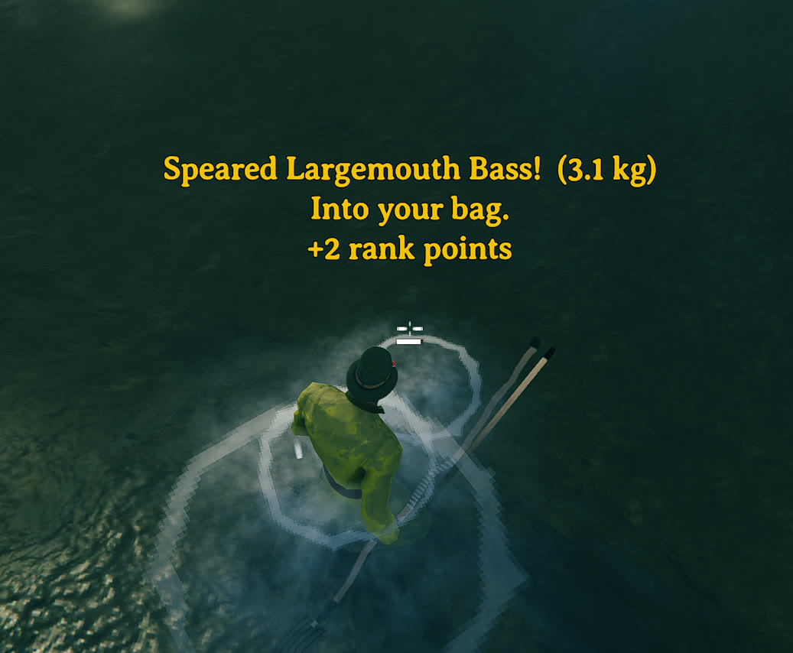

## Ice fishing

In the Deep North (and on the Mountain's frozen lakes) the water is covered in ice you can walk on. Nothing can be cast
onto it: drill a hole and fish down it. Three fish live only under the ice and bite nowhere else: the **Lake
Whitefish**, the **Burbot** (at night, on the bottom) and the legendary **Ice King Trout**. The cold-water fish of the
place bite through a hole too.

**The Ice Auger** (Forge 3: Iron 4, Fine wood 2, Silver 2). Stand on the ice and attack: you set the auger upright and
twist its T-handle until the bit breaks through, and a hole opens in the ice in front of you. It needs at least 1 m of
water underneath. A hole freezes over again after 20 minutes, skinning over in the last two. Press **E** on it to
scoop out the slush and keep it open as long again.

**The Ice Fishing Rod** (Forge 3: Fine wood 4, Gold 2, Elaking hair bundle 3) is a short rod with a bloodgold reel
and an Elaking-fur grip. It fishes only through a hole, with a longer hook window there; any other rod works in a hole
at half the window. Stand at a hole and click to drop the line straight in; hold the click to let it down further.
Jig it with the **Grub Jig** or the **Rime Jig** (see [Lures and trailers](#lures-and-trailers)). Carried, it hangs
in your left hand; with the line down you hold it out over the hole.

### Shelters

Three shelters to fish the ice from, built with the hammer (Furniture, near a workbench). You walk into each one: it
counts as shelter for resting, and a fire inside doesn't smoke you out. Drill a hole inside and the fish bite sooner,
because they can't see you against the sky.

| Shelter | Materials | Bites sooner | |
|---|---|---|---|
| Hide Lavvu | Wood 20, Wolf pelt 6, Leather scraps 8 | +10% | A cone of poles under sewn hides, open at the top for smoke |
| Ice Shelter | Ice 30, Stone 5 | +15% | An igloo of the game's own ice blocks, with a vent at the top and an ice bench |
| Ship-Tent | Fine wood 12, Elaking hair bundle 4, Lox pelt 4, Iron 2, Stone 5 | +20% | A Viking ship's tent with dragon-head gables; comes with a campfire at the back |

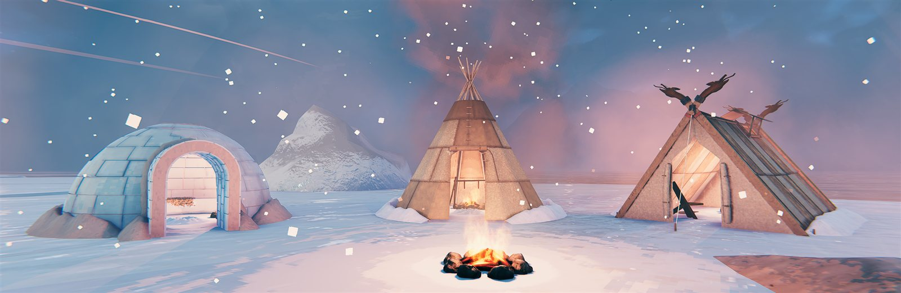

The **Ice Shelter**'s ice bench runs round its back wall, under a deer hide: three seats, so you can sit and fish the
hole in the middle.

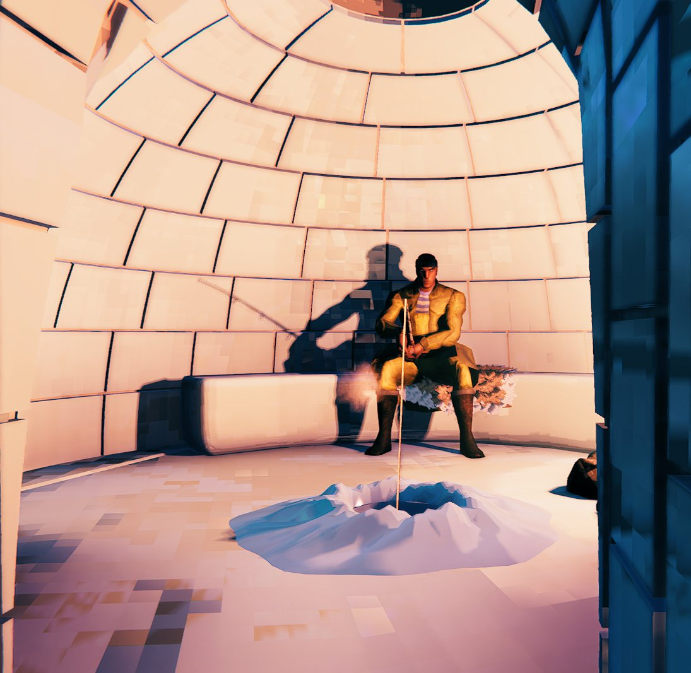

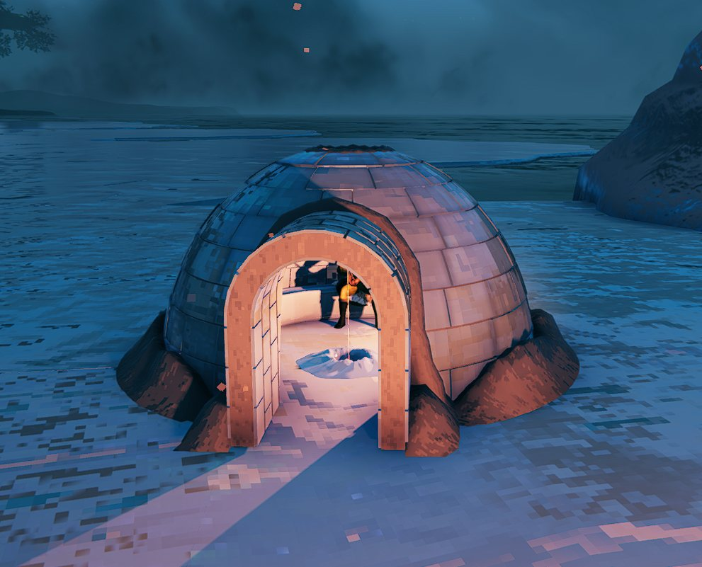

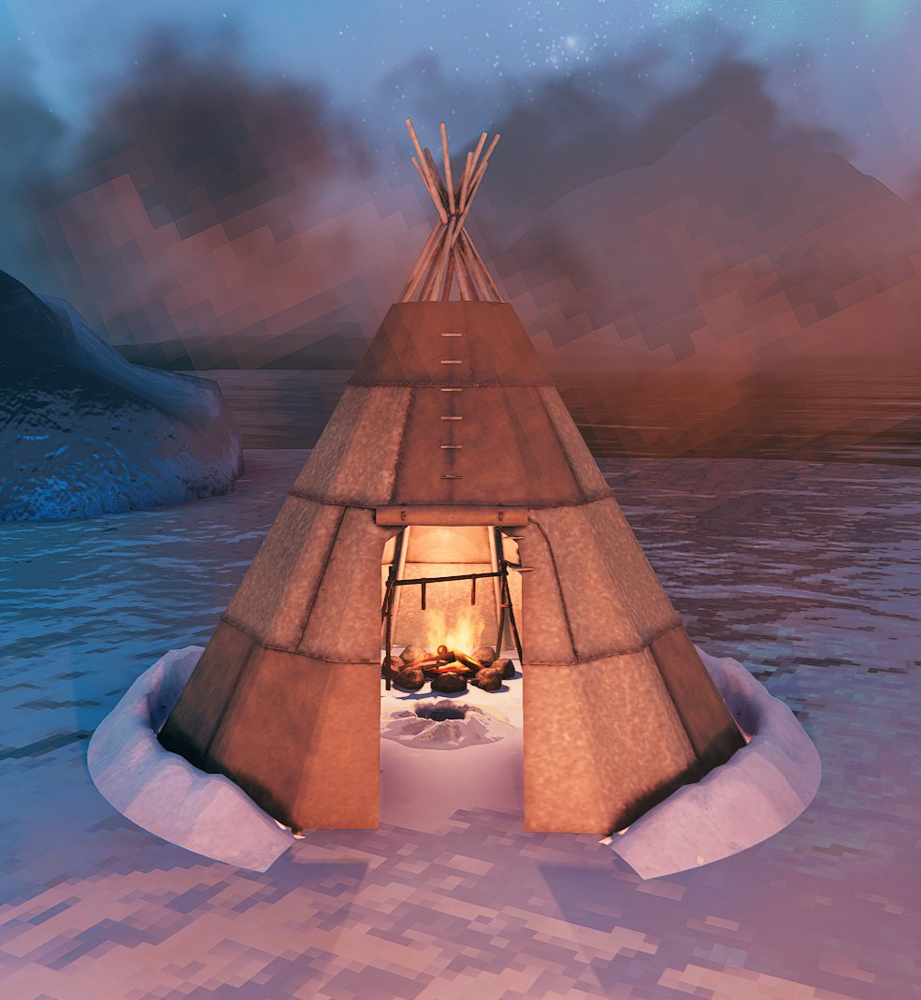

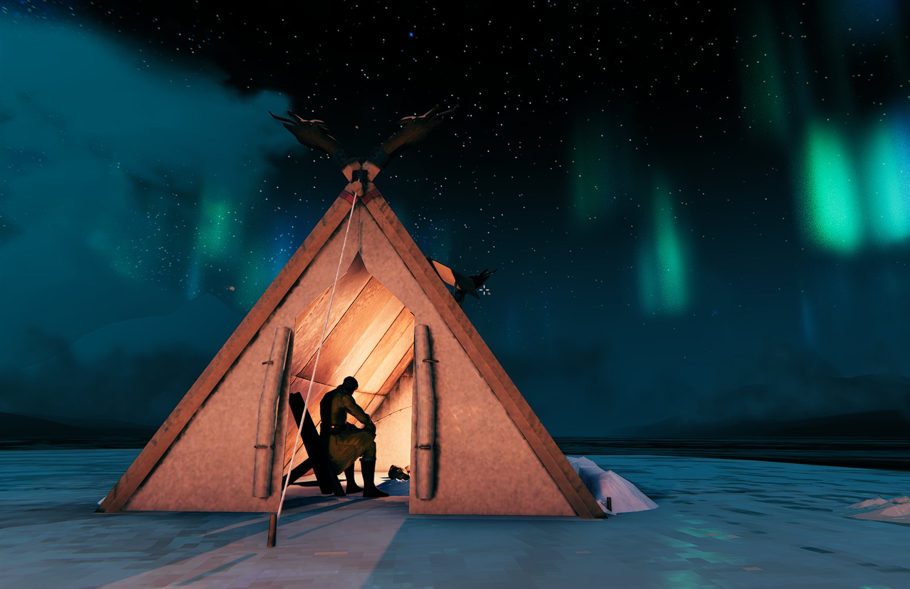

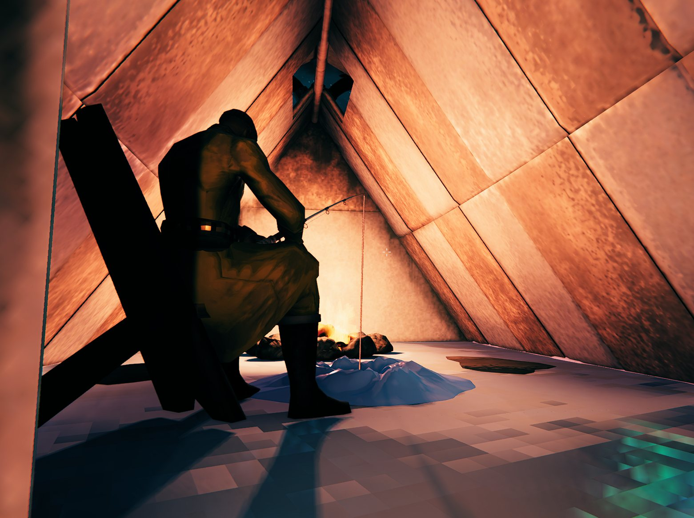

### Rod holders and racks

The **Rod Holder** (Workbench: Wood 4, Leather scraps 2) is a forked stake for the bank or the ice. Set a rod in it
with its line out and the line keeps fishing while you do something else; you can run several at once. When a fish
bites, everyone nearby is told, a circle hook sets itself, and anyone can take the rod up and fight it. The **Rod
Rack** (Workbench: Fine wood 8, Iron 2, Leather scraps 4) stores ten rods.

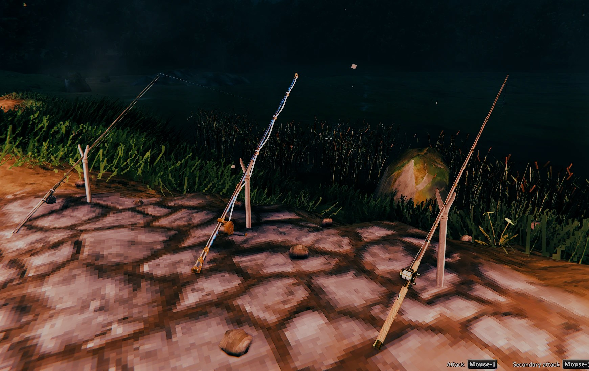

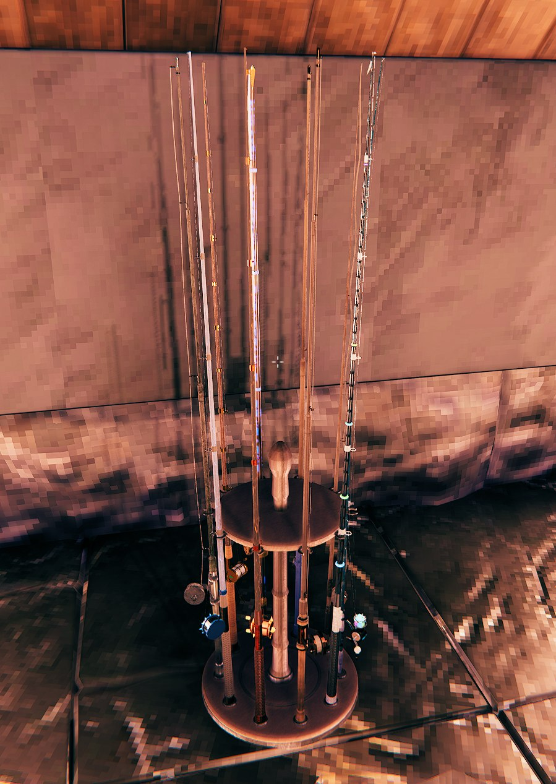

## Fishing Boat

A small rowing boat built with the hammer at a workbench (24 wood, 8 resin, 4 deer hide). Use the bench to row
(forward and back only; it has no sail, so the wind doesn't move it). It has a passenger seat at the stern, a
holdfast in the bow to stand braced in rough water, and a ladder on the side to climb in from the water. Fish you
land while aboard any ship go straight into your inventory.

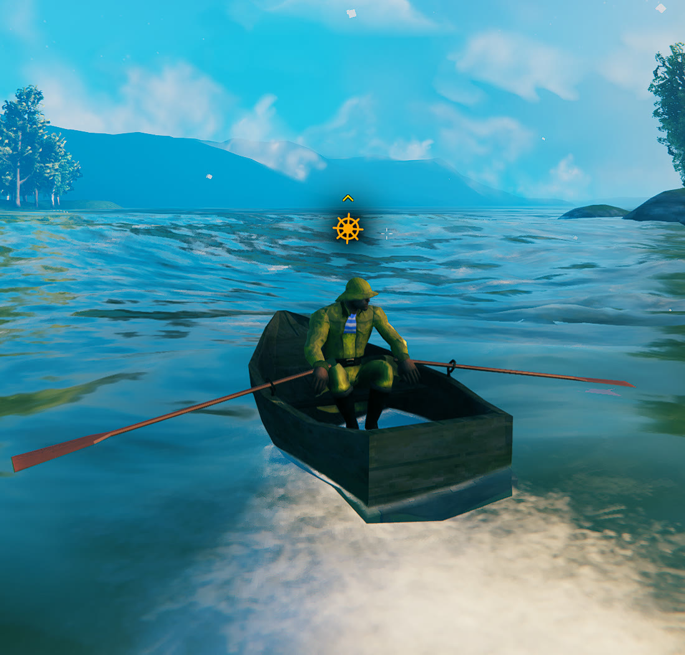

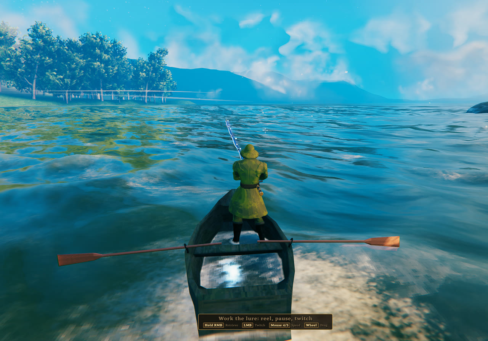

## The tackle screen

The tackle screen opens beside your inventory: the whole rod pictured, with a slot for each part of the rig -
**rod, reel, line, float, hook, bait (or lure), weight and leader** - and the rig's stats beside it (collapsible).
To fill a slot, drag the item in, or right-click or Ctrl+click it in your inventory (Ctrl+click a slot to take it back
out). Drag the screen by its wood to put it anywhere; double-click its title to put it back.

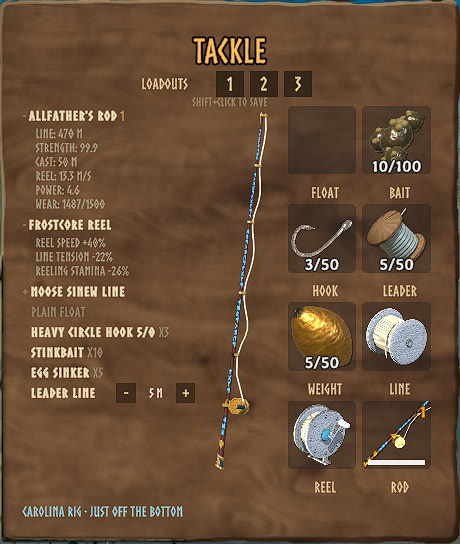

- **Rod:** a rod in the rod slot takes no inventory space. Right-click the slot, or press `Alt+F`, to take it in hand
  or put it away. It repairs and upgrades from the slot (upgrading moves it into your inventory first).
- **Reel and line:** a reel reels faster, eases the tension and saves stamina; a line adds line on top of the rod's
  own. Each era has its own (below). Without them the rod fishes with its own reel and line.
- **Float:** the float your line wears (see Floats below).
- **Bait and hook:** while holding the rod, `B` / `H` swaps in the next bait or hook you're carrying. A slot refills
  from your inventory, then from the tackle box you're wearing, when it runs out.
- **Weight and leader:** see Weights, leaders and depth below.
- **Loadouts 1, 2, 3:** Shift+click a loadout to save your tackle to it, click it to put that tackle on again (from
  what you carry).

| Reel | Made at | Reel speed | Tension | Reeling stamina |
|---|---|---|---|---|
| Bronze Reel | Forge 1 | +10% | | -5% |
| Iron Reel | Forge 2 | +15% | -5% | -8% |
| Silver Reel | Forge 3 | +20% | -8% | -12% |
| Black Metal Reel | Forge 5 | +25% | -10% | -15% |
| Dvergr Reel | Black forge 1 | +30% | -14% | -18% |
| Flametal Reel | Black forge 2 | +35% | -18% | -22% |
| Frostcore Reel | Black forge 3 | +40% | -22% | -26% |

| Line | Made at | Extra line |
|---|---|---|
| Leather Line | Workbench 2 | 15 m |
| Guck-Waxed Line | Forge 1 | 30 m |
| Linen Line | Forge 5 | 60 m |
| Sap-Coated Line | Black forge 1 | 90 m |
| Morgen Sinew Line | Black forge 2 | 120 m |
| Moose Sinew Line | Black forge 3 | 150 m |

Turn off **Reels, Lines and Floats** in the settings to play without them: rods fish with their own reel and line,
reels and lines can't be crafted, and floats are used like a mead for a while.

Tackle is saved with your character and goes into your tombstone when you die.

### Floats

A float goes in the float slot, and your line wears it until you swap it. Each has a small effect:

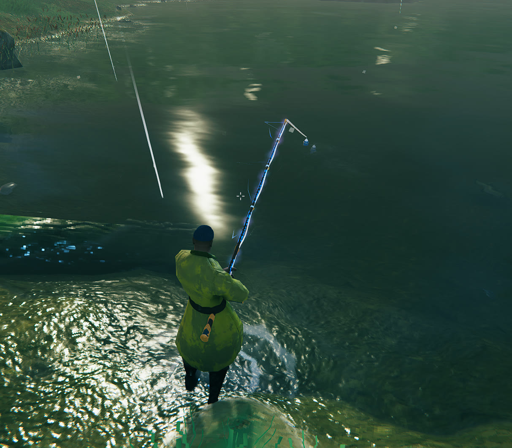

| Float | Made at | Effect |
|---|---|---|
| Quill Float | Workbench 1 | 1 fewer nibble before the bite, +5% hook chance |
| Lantern Float | Workbench 2 | At night, fish bite 50% sooner; 1 fewer nibble; lit after dark |
| Cork-and-Antler Float | Workbench 2 | In rivers and lakes, fish bite 35% sooner |
| Bone Float | Workbench 3 | Fish don't flee from your noise; 1 fewer nibble |
| Frost Float | Workbench 4 | In the Mountain and Deep North, fish bite 40% sooner; +15% hook window |
| Linen Bob | Workbench 4 | +35% hook window |
| Eitr Float | Workbench 5 | In water 10 m or deeper, fish bite 40% sooner; a violet light after dark |
| Ember Float | Workbench 5 | In the Ashlands, fish bite 45% sooner; an orange light after dark |
| Rime Float | Workbench 5 | -15% line tension |

The Lantern Float's candle wick comes from the Bog Witch.

## Weights, leaders and depth

Every fish feeds at its own depth (near the surface, mid-water, or on the bottom), and a fish is about twice as
likely to take a bait at its depth - much less far from it. Your rig decides how deep the bait sits:

| Rig | On the line | The bait sits |
|---|---|---|
| Float | bait + hook | about 1 m down (in shallow water that reaches the bottom) |
| Float and leader | + Leader Line | as deep as your leader (0.5-40 m, set with - and + on the tackle screen) |
| Bottom rig | + any weight, no float | on the bottom; the cast goes further |
| Carolina rig | Egg Sinker + Leader Line | just off the bottom; fish take it more readily |
| Texas rig | Bullet Weight + a soft lure | the lure works along the bottom |

With a weight there's no float: nibbles show as taps on the rod tip. Weights: Split Shot (tin), Bullet Weight
(copper), Egg Sinker (bronze) and Pyramid Sinker (iron); the Leader Line is made at the workbench. They're only lost
when the line snaps. The water moves a weight that's too light for it: waves, wind and storms drag it along the
bottom, and nothing bites while it's dragged - only a Pyramid Sinker holds at sea, and only a storm shifts that.

## Tackle boxes

A tackle box holds tackle - bait, lures, hooks, weights, leaders and floats - and keeps it inside wherever the box
goes: your inventory, a chest, your grave. It weighs what's in it.

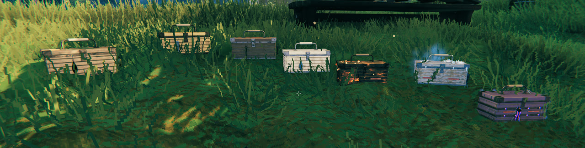

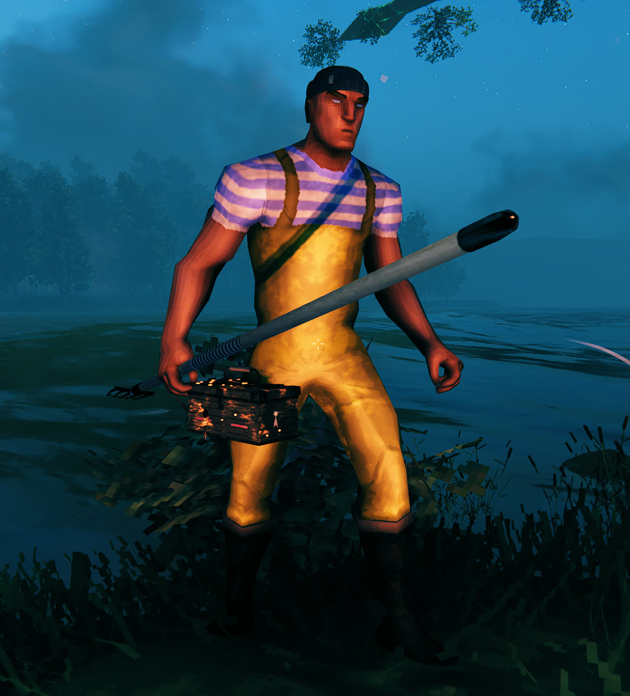

| Box | Biome | Made at | Slots |
|---|---|---|---|
| Tackle Box | Meadows / Black Forest | Workbench 2 | 8 |
| Iron-Bound Tackle Box | Swamp | Forge 2 | 12 |
| Silver Tackle Box | Mountain | Forge 4 | 16 |
| Black-Metal Tackle Box | Plains | Forge 4 | 20 |
| Dvergr-Mended Tackle Box | Mistlands | bought from Hildir | 30 |
| Charred Tackle Box | Ashlands | bought from Hildir | 35 |
| Rime-Crusted Tackle Box | Deep North | bought from Hildir | 40 |

The last three are Hildir's own make: she sells each once you've brought back the one she lost in that biome (below).

Wear it in the utility slot: it's carried by its handle in your right hand when that hand is free, at your hip
otherwise. Press `K` to open it, and `Shift+K` to set it down as a chest whose lid opens for anyone using it; `E`
opens a set-down box and `Shift+E` picks it up with everything inside. Your tackle slots refill from the box you're
wearing.

## Coolers

A cooler holds your catch - fish, raw fish, fillets, roe and dried fish - and keeps it fresh. Like a tackle box it
keeps what's inside wherever it goes, and weighs what's in it.

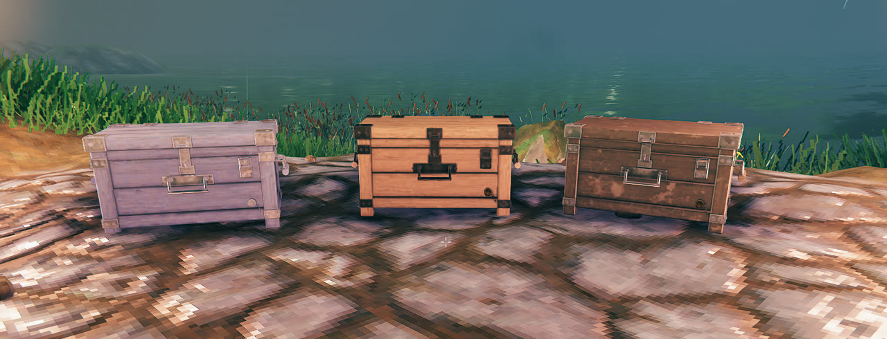

| Cooler | Made at | Slots | Fresh for | Materials |
|---|---|---|---|---|
| Wooden Cooler | Workbench 2 | 12 | 10 min | Fine Wood 8, Resin 6, Leather Scraps 4 |
| Iron-Banded Cooler | Forge 2 | 15 | 20 min | Fine Wood 10, Iron 4, Guck 4, Fish Oil 4 |
| Frost Cooler | Forge 4 | 24 | 45 min | Fine Wood 10, Silver 4, Freeze Gland 4, Crystal 2 |

Coolers aren't worn. Right-click one in your inventory to set it down; `E` opens it (frost curls inside while the lid
is up) and `Shift+E` picks it up with everything inside.

Nothing spoils. Fish in a cooler, carried or set down, stay **fresh** for the cooler's time after they come out (the
tooltip says how long). A fresh fish sells for 25% more at the traders, and gives one more material when you clean it
at the Cleaning Table.

## Fishing buffs

Tiered items that unlock as you progress:

- **Meads** (brewed like Valheim's): Angler's Mead (faster bites), Steady-Hand Tonic (easier hookset), Troll-Grip Mead
  (reel speed and stamina). Make the **mead base** at the **Mead Ketill**, put it in a **fermenter**, and it comes out as
  6 meads, the same as vanilla meads and tonics.
- **Lingonberry Angler's Mead** (base at the Mead Ketill): a strong all-rounder for the Deep North - faster bites, easier
  hookset and longer fights. **Spawning Musk** is brewed the same way.
- **Rune of Njord** (forge, worn as a belt): bigger fish, more legendaries.
- **Chum** (cauldron, with 2 Cut Bait): set the bucket down on the bank to draw more, less picky fish to the water
  around it for 5 minutes, for anyone fishing there.
  **Blubber Chum** (seal blubber, lingonberries) is the strongest and lasts 6 minutes.
- **Totems** (hammer): the Fisherman's Totem and Shrine of Njord buff anyone fishing nearby.
- **Relics** (can't be crafted, and each takes a slot of its own - they don't stack). Each comes from one place:

  | Relic | Where it comes from |
  |---|---|
  | Horn of Ægir | Hildir's prize for your 15th fishing bounty |
  | Pearl of Njord | Logging every species in the catch log |
  | Golden Hook | Very rarely (about 1 in 50) found inside a legendary fish you land |
  | Jörmungandr's Scale | Very rarely (about 1 in 33) dropped by a sea serpent you kill |

  The Hook and the Scale can turn up again; Hildir buys spares.

## The Bog Witch

Her wares go into fishing:

| Her ware | Goes into |
|---|---|
| Pungent Pebbles | **Stinkbait** (cauldron): catfish, trollfish, pike, mistfin and bass love it |
| Fresh Seaweed | **Seaweed Chum** (cauldron 2): more, keener fish for 6 minutes |
| Candle Wick | **Lantern Float** (workbench 2): a candle-lit float; fish bite 50% sooner at night (see Floats) |
| Love Potion | **Spawning Musk** (a mead base at the Mead Ketill, fermented): legendary fish 50% more likely for 10 minutes |
| Powdered Dragon Eggshell | Major Steady-Hand Tonic |
| Toadstool | Major Troll-Grip Mead |
| Her herb blends | The fish feasts |

**Fish feasts** are made in the cauldron and set down with her **Serving Tray**, like vanilla feasts, for
everyone to eat from:

| Feast | Cauldron | Herbs | Health / Stamina / Eitr |
|---|---|---|---|
| Lakeside Fish Fry | 2 | Woodland Herb Blend | 40 / 40 |
| Fin and Onion Hotpot | 3 | Mountain Peak Pepper Powder | 55 / 50 |
| Sea-Fish Spread | 3 | Seafarer's Herbs | 50 / 60 |
| Roe and Barley Platter | 4 | Grasslands Herbalist Harvest | 60 / 70 |
| Abyssal Ink Banquet | 5 | Herbs of the Hidden Hills | 60 / 45 / 70 |
| Ember Fish Platter | 5 | Fiery Spice Powder | 85 / 60 |
| Rime Fish Smorgasbord | 5 | the Deep North spice | 90 / 75 / 35 |

She also sells Stinkbait, Lantern Floats and (after Bonemass) Spawning Musk, and each **boss lure** once you've
beaten that boss, so a failed summoning doesn't mean hunting a new trophy.

## Hildir

**Fishing bounties.** Hildir posts one bounty a day for a species you've caught: at least so heavy, sometimes caught in
the rain, at night or Trophy-size. Hand the fish in from the trade panel for coins and bait. Your 5th, 15th and 30th
bounties earn a Yule Hat, the Horn of Ægir and Megingjord, with a Thunder Stone at 10 and a Dverger Circlet at 20.

**Lost tackle boxes.** Three of Hildir's tackle boxes turn up in dungeon chests. Give one back (use it on her, or from
the trade panel) and her shop gains more:

| Box | Found in | Hildir starts selling |
|---|---|---|
| Dvergr-Mended Tackle Box | Mistlands dvergr ruins | the Dvergr-Mended Tackle Box (30 slots, 1000), Mist-Dyed Fisherman's gear, Bone Jigs, Abyssal Bait |
| Charred Tackle Box | Ashlands ruins and Charred fortresses | the Charred Tackle Box (35 slots, 1300), Ash-Dyed Fisherman's gear, Silver Swimbaits, Abyssal Bait |
| Rime-Crusted Tackle Box | Deep North villages and Mörkhalla | the Rime-Crusted Tackle Box (40 slots, 1600), Rime-Dyed Fisherman's gear, Frostcore Jigs, Northern Bait |

The dyed gear is bought, not crafted, but repairs at the workbench (level 2) like the rest of the set.

**Her stock in recipes.** Some of what she sells makes fishing gear:

| Made from her | Makes | Where |
|---|---|---|
| Sparkler | **Sparkler Popper**: a topwater lure that fizzes and lights the water after dark | Forge 1 |
| Basic Fireworks | **Angler's Flare** (with fish oil): carry one and it goes up by itself when you hook a boss fish - a firework over you, a ping on everyone's map and a shout naming the boss | Workbench 2 |
| Grey Fur Cap | **Ice Angler's Watch Cap** (wolf pelt, rime scales): +15% hook window, and it keeps the frost off | Workbench 2 |
| Simple Red Cap | **Sun Angler's Cap** (feathers, fish scales): by day, fish bite 25% sooner | Workbench 2 |

## Fisherman's gear

A light armour set made at the workbench (level 2): the **Sou'wester**, **Oilskin Coat** (worn as a cape), **Striped
Fisher's Shirt** and **Oilskin Overalls** with rubber boots. Wearing all four keeps the rain off (you never get Wet)
and makes reeling cheaper and the hookset window longer.

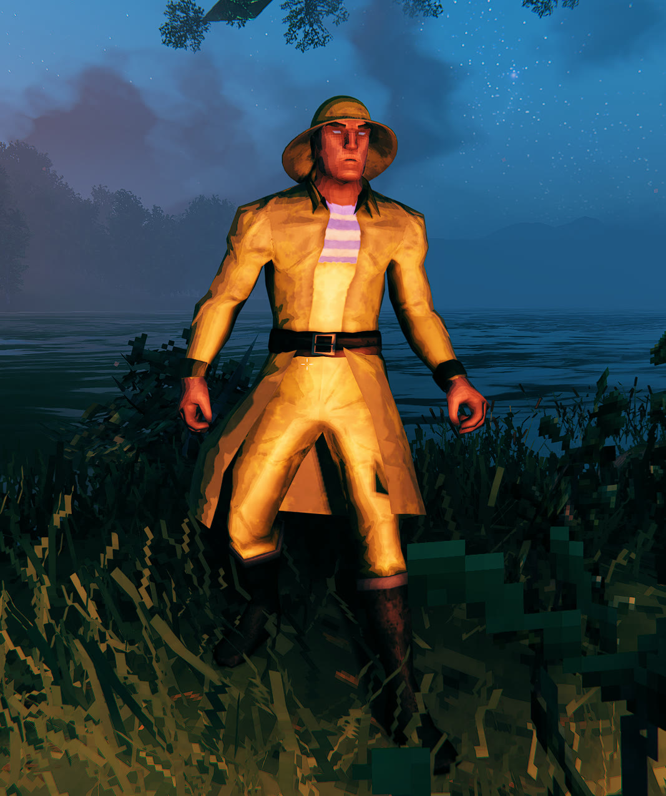

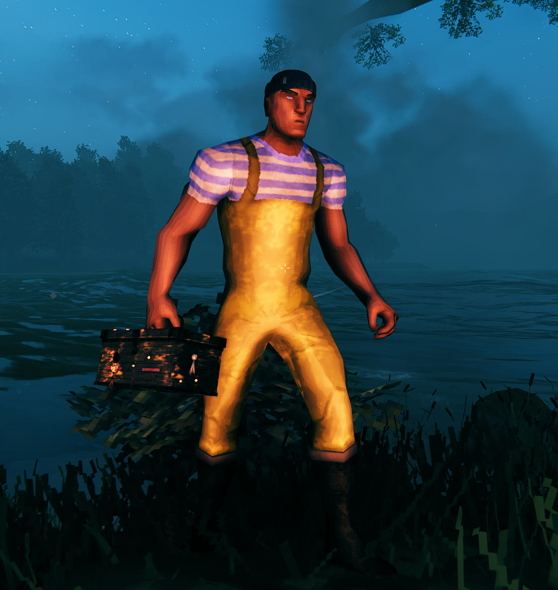

Two **angler caps** made from Hildir's caps (above) can be worn instead of the Sou'wester: the Ice Angler's Watch Cap
and the Sun Angler's Cap. They aren't part of the set.

## Your catch

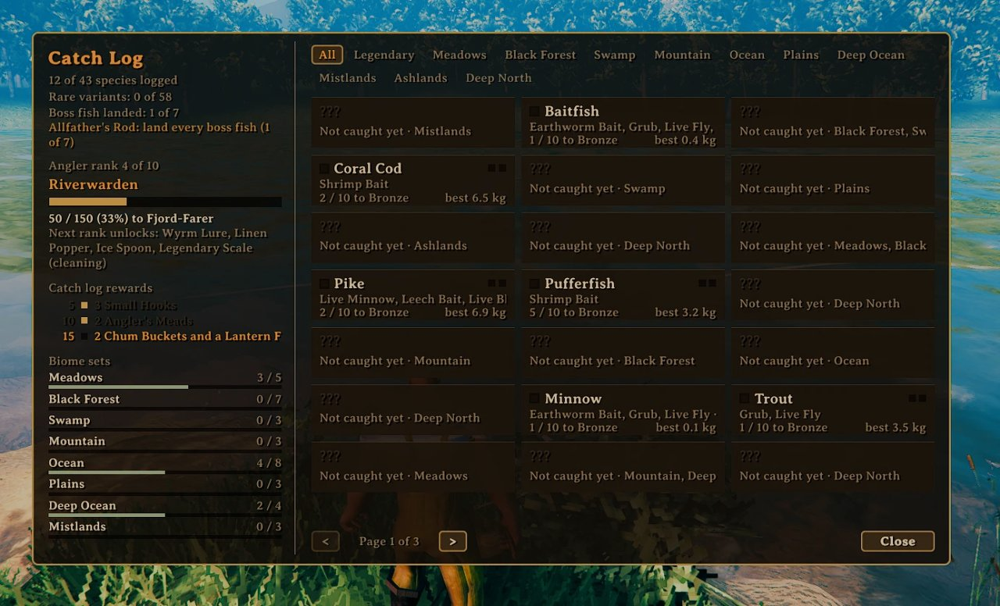

- **Size class:** each fish is Small, Medium, Large or Trophy, with its weight and catcher in the tooltip.
- **Rare variants:** any ordinary species can come up **golden** (about 1 in 300) or **albino** (about 1 in 150), its
  icon and model tinted to match. They never stack with ordinary fish, earn rank points (+10 golden, +5 albino), sell
  for more (Haldor 5x / 3x, Hildir 6x / 4x) and each species' card in the catch log marks which you've caught.
- **Trophy Mount** (hammer: fine wood, resin): hang a fish on the wall.
- **Cook and sell:** cook fish on a cooking station, and sell your catch to the traders. Each buys their own kind:

  | Trader | Buys |
  |---|---|
  | Haldor | Raw and cooked fish, at their value |
  | Hildir | Trophy-size fish (2.5x) and legendary fish (1.5x) for her collection, and spare relics (400) |
  | Bog Witch | Roe, fish oil, abyssal ink, brined roe, leeches, and swamp, Mistlands and eel-like fish (1.4x) |

  Your catch sells from the **Sell your catch** panel beside the store window (it works alongside trader UI mods);
  click a row to pick what to sell, or Sell all. The store's own sell button sells vanilla valuables, as in vanilla.
- **Catch log** (`J`): records every species you catch, with your angler rank, the reward ladder and biome sets in a
  sidebar and each species as a card (its bait, mastery and record). The mouse is free while it's open: click a biome to filter, the arrows or the wheel to turn pages, Close (or J / Escape) to shut it.
  - **Rewards** every 5 species (hooks, meads, chum, a Lantern Float, a Trophy Fin, coins) and the Pearl of Njord for
    all of them.
  - **Biome sets:** catch every non-legendary fish of a biome *in that biome* for 10 of its bait, some coins and 25
    rank points. A fish that lives in two biomes (pike: Black Forest and Swamp) has to be caught in each to count for both.
  - **Finds:** now and then a catch has a valuable inside (amber, amber pearls, rubies, silver necklaces, by where you
    fish): rarely in small, common fish, more often in big or rare ones.
  - **Personal best:** +5 rank points. **Each angler rank** comes with a small gift.
- **Species mastery:** catch enough of one species and it gets easier for you. Each tier also gives angler rank
  points (10 / 20 / 40), and the catch log shows a bronze, silver or gold mark and the count to the next tier.

  | Tier | Catches (legendary / boss) | For that species |
  |---|---|---|
  | Bronze | 10 (1) | It comes to your bait more often and takes it more readily |
  | Silver | 25 (3) | It pulls and lasts 10% less |
  | Gold | 50 (5) | It runs bigger, and you can build its **Gold Trophy Plaque** with the hammer (fine wood, bronze, resin) |

  Baitfish only go to Bronze. A plaque is a wall piece with a gold-plated fish of that species mounted on it and its name on a gold nameplate (a boss fish is mounted at 80% of its true size on a board grown to fit it, for 10 fine wood, 3 bronze and 5 resin); turn it to face out from the wall.
- **Angler ranks:** ten ranks, shown at the top of the catch log with a bar to the next rank and what it unlocks.
  Points: 10 per new species (40 for a legendary), 1 per fish landed, 5 per Trophy-size catch, 1 per 10 kg landed and
  10 / 20 / 40 for each species' mastery tiers.
  The top rods, lures and Fish Cleaning Table recipes stay hidden from the crafting list until you reach their rank.
  (The Bog Witch still sells boss lures to anyone.)

  | Rank | Points | Unlocks |
  |---|---|---|
  | Thrall of the Shallows | 0 | - |
  | Minnow-Karl | 40 | Antler Lure |
  | Net-Weaver | 100 | Root Lure, Silver Swimbait |
  | Riverwarden | 200 | Silver Fishing Rod, Ooze Lure, Brined Roe |
  | Fjord-Farer | 350 | Wyrm Lure, Linen Popper, Ice Spoon, cleaning for Legendary Scales |
  | Skerry-Reaver | 550 | Black Metal Fishing Rod, Dried Fish |
  | Wave-Jarl | 800 | Yggdrasil Fishing Rod, Ember Lure |
  | Serpent-Slayer | 1,100 | Ashwood Fishing Rod, Chitin Lure, Frostcore Jig, cleaning for Cinder Scales |
  | Ægir's Hand | 1,500 | Frostwood Fishing Rod, cleaning for Rime Scales |
  | Chosen of Njord | 2,000 | Crown Lure |
- **Fishing skill:** Valheim's Fishing skill rises as you reel and land fish. It makes reeling cheaper and
  faster and setting the hook easier.

## Settings

The config is `BepInEx/config/valheimdeepwaters.cfg`.

| Setting | Default | |
|---|---|---|
| Show Fishing HUD / HUD Scale | on / 0.85 | The bait, tension, line and drag display |
| Weight Unit | Kilograms | Fish weights in kilograms or pounds |
| Reel Sound Volume | 0.5 | |
| Rod Wear | 1 | 0 = rods never wear out |
| Reels, Lines and Floats | on | Off: rods fish with their own reel and line, and floats are used like a mead |
| Spawn Swimming Fish / Swimming Fish Density | on / 1 | Deep Waters fish in the world |
| Spawn Worm Mounds / Worm Mound Density | on / 0.5 | Compared to red mushrooms; new areas only |
| Rain Worms | on | |
| Spawn Flies | on | |
| Cycle Bait / Cycle Hook / Catch Log keys | B / H / J | |
| Rod Key | Alt + F | Takes the rod in your rod slot in hand, or puts it away |
| Tackle Box Key / Set Down Key | K / Shift + K | Opens the tackle box you're wearing / sets it down as a chest |
| Tackle Screen Position | (beside the inventory) | Set by dragging the screen; empty, or double-clicking its title, puts it back |
| Move HUD Key | Alt + U | Moves and resizes the fishing HUD (see below) |
| HUD Position: Bait and Line / Drag and Reel / Key Hints / Boss Bar | (usual place) | Set in the HUD's move mode; empty puts a part back |
| HUD Size: Bait and Line / Drag and Reel / Key Hints / Boss Bar | 1 | 0.5 - 2, on top of HUD Scale; also set in the move mode |
| Drag Control / Reel Speed Control | Mouse Wheel / Alt + Mouse Wheel | Either can be the mouse wheel, Alt + mouse wheel or the mouse side buttons (Mouse 5 up, Mouse 4 down) |

**Moving the HUD.** Press **Alt + U** to move and resize the fishing HUD. Its four parts - the bait, tension and line
panels, the drag and reel dials, the key hints and the boss bar - show as frames. Drag one to move it, scroll over it
or drag its corner handle to resize it, and double-click it to put it back. Alt + U or Escape when done. Each part's
place and size are saved in the config.

## Console commands (server admins)

These need `devcommands`, like Valheim's own spawn command.

- `vdw_give <item> [amount]`: gives an item, for example `rod_copper`, `hook_small`, `tackle_egg_sinker`,
  `tacklebox_t2`, `cooler_c1`, `buff_angler_minor`, `worm` or a fish id.
- `vdw_debug catch <fish id>`: the next cast brings that fish straight to the bait (for trying a fish out).
- `vdw_debug bite`: the next cast gets a bite straight away.
- `vdw_debug listrods | listhooks | listbait | listfish | listbuffs`: lists the item ids.
- `vdw_debug resetlog`: clears your catch log.
- `vdw_debug tokens`: exports the mod's text for translating (see Translations below).

## Customising

### Fish, bait, rods, hooks and buffs

These are defined in `Fish.json`, `Baits.json`, `Rods.json`, `Hooks.json`, `Tackle.json` (reels, lines, weights and leaders) and `Buffs.json` (meads, chum, floats and relics) in
`BepInEx/config/ValheimDeepWaters/`. They're created on first run, and your edits are never overwritten. When
an update adds new fish, bait, rods, hooks or buffs, they're added to your files automatically (each one only
once, so an entry you delete stays deleted). Delete a whole file to get its defaults back.

### Custom models

The mod's own models ship in a `Models` folder beside its DLL in `BepInEx/plugins`. To use your own, put model files in `BepInEx/config/ValheimDeepWaters/Models/` (create the folder); a file there replaces the shipped one of the same name:

| Name | Model for |
|---|---|
| `rod` or `rod_<id>` | Rods (one shared model, or one per rod) |
| `bobber` | The float |
| `bait_<id>` / `hook_<id>` / `fish_<id>` | That item (fish models also swim in the world) |
| `tackle_<id>` / `buff_<id>` | Reels, lines, weights and leaders / floats, meads, chum and relics as items |
| `float_<id>` | A float on the line |
| `leister_<tier>` | A leister (fitted onto the vanilla spear it's made from) |
| `pickable_worm` | Wriggling soil |
| `fly` | Flies (without one, Valheim's own flies effect is used) |

The mod looks for each model in this order:
1. `<name>.bundle`
2. A prefab called `<name>` inside any `.bundle` in the folder, so all your baits can share one bundle
3. `<name>.obj` with an optional `<name>.png` texture

Build bundles with Unity 6000.0 and turn on **Read/Write** for the model.

Sizing: every model is used at **exactly its size in Unity** - 1 unit = 1 metre, the mesh times every transform
in its prefab (the root included). Nothing is resized, so build each model at the size you want it in game:
model in metres in Blender (Metric, Unit Scale 1), apply all transforms, export FBX with Apply Scalings "FBX
All", -Z Forward, Y Up and Apply Transform, and import in Unity with Scale Factor 1 and Convert Units on. Face
models forward along +Z. With debug logging on (see Troubleshooting), the log shows each model's final size in metres.

Icons:
- A `<name>_icon.png` in the folder becomes that item's icon.
- Otherwise the icon is rendered from the model.

### Animated fish

A fish model can be rigged and animated instead of static. Make it a prefab in a bundle, like any other
model, with:

- a **skinned mesh** (an armature: a spine chain of 4-6 bones from head to tail, plus fins if you like),
  modelled at real size and facing forward along +Z
- an **Animator** (Rig: Generic) whose controller has states named **`Swim`** (default, looping), **`Thrash`**
  (looping) and optionally **`Flop`**, and optionally a float parameter **`Speed`** that scales them. A legacy
  `Animation` component with clips of those names works too.

The mod then uses the whole prefab: it swims in the world (faster as it moves), darts at your bait when it
nibbles, thrashes when it runs and leaps on the line and swims slowly when it rests, flops when dropped on land,
and holds still as a trophy. Missing clips fall back to `Swim`, and static models keep working as before, so
fish can be animated one at a time. Model it at its real size: it is used exactly as big as it is in Unity.

### Rigged rods

A rod model can have a skeleton so it bends and its reel turns. Make it a prefab in `rod.bundle` (or
`rod_<id>.bundle`) with a **skinned mesh** and these bones (any you leave out just don't move):

- **`Rod.1` .. `Rod.N`**: a chain up the blank from just above the reel to the tip. Most of the bend goes to the
  top segments, like a real blank.
- **`Rod.Tip`**: where the line leaves the rod. The line follows it as the rod bends.
- **`Rod.BendDir`**: a marker beside the tip, on the side the rod bends toward (the guide side).
- **`Reel.Spool`**: the part of the reel that turns (the crank and drum), and **`Reel.Axis`**, a marker along its
  axle.

No Animator is needed: the mod poses the bones itself. The rod bends toward the line, harder as a fish pulls
toward the breaking point. It flexes back as you wind up a cast, whips forward on release and springs back when
the line snaps. The reel winds in while you reel and spins backward as line pays out.

### Translations

Run `vdw_debug tokens`, translate the file it writes, and save it as
`Translations/<Language>/vdw.json` inside the mod's folder in `BepInEx/plugins` (any folder named `Translations` there works).

## Multiplayer

Every player needs the mod, the same version as the server (the game checks when you join).
- **Server rules:** the gameplay settings (marked "Set by the server" in the config) come from the server, so
  everyone plays by the same rules. HUD, sound and keys stay each player's own.
- **Shared:** caught fish, worm mounds, totems and trophy mounts are normal world objects that everyone sees.
- **Watching others fish:** players within 90 m see your line, float or lure, the fish on your hook (running, leaping,
  thrashing - a boss too, the Queen Eel's humps, rearing and tail slaps included), the splashes and bites, and hear your reel. A fish you land is news for players within 50 m; a boss fish
  is announced to the whole server.
- **Per player:** the fight HUD, flies and rain worms only show for the player who has them.

## Troubleshooting

The mod writes a few lines to the BepInEx log when it starts, plus warnings if something is missing. For a
detailed log (every model loaded, and more), add `Debug` to `LogLevels` under `[Logging.Disk]` in
`BepInEx/config/BepInEx.cfg`.

## Credits

Several fish are built on models from Sketchfab, used under their licences:

| Fish | Model | Author | Licence |
|---|---|---|---|
| Bonemaw | [Pacific Viperfish](https://sketchfab.com/3d-models/pacific-viperfish-21368fef466343b4b9d0ca11f2cff468) | redsonder1000 | CC BY |
| Frost Char | [White-spotted Charr](https://sketchfab.com/3d-models/cc0-white-spotted-charr-605079fc074f451db012579f67457629) | ffish.asia / floraZia.com | CC0 |
| Frost Sculpin | [Roughskin Sculpin](https://sketchfab.com/3d-models/cc0-roughskin-sculpin-t-fasciatus-dda1cde382f146eeb8f767e09d475ec5) | ffish.asia / floraZia.com | CC0 |
| Greydwarf Goby | [Freshwater Goby No.1](https://sketchfab.com/3d-models/freshwater-goby-no1-5b637be8e9ca4bd0ac6e71657c9d75d5) | Thomas Flynn | CC BY |
| Halibut | [Bastard Halibut](https://sketchfab.com/3d-models/cc0-bastard-halibut-p-olivaceus-abaafcb174bc44f1a0206e267925bc8f) | ffish.asia / floraZia.com | CC0 |
| Jotunn Perch | [European Perch](https://sketchfab.com/3d-models/european-perch-ca1bef303691418f9788a5b1ca1870d5) | doublesob | CC BY-NC |
| Mackerel | [Atlantic Mackerel](https://sketchfab.com/3d-models/atlantic-mackerel-e4a92741c16448e38a0be59845ab369b) | NewViStudios | CC BY |
| Odin's Eye | [Opah fish](https://sketchfab.com/3d-models/opah-fish-d5bd15eb103e4e909fe91efe37c65f50) | Batton | CC BY |
| Serpentfin | [Oarfish](https://sketchfab.com/3d-models/oarfish-7a60a4df5af940e58ff1f300609e7ee2) | TheoBaldeteBRID | CC BY |
| Surtling Sardine | [Sardine](https://sketchfab.com/3d-models/sardine-d7a2d0bd2a524d35b01e0d898b026479) | Drake | CC BY |
| Thor's Hammerhead | [Scalloped Hammerhead Juvenile](https://sketchfab.com/3d-models/scalloped-hammerhead-juvenile-low-poly-f5adc17c922b48feae76aaea98552dd4) | sharkingaround | CC BY |
| Trout | [Rainbow Trout - Redband](https://sketchfab.com/3d-models/rainbow-trout-redband-442ab10476d0486e8eb689941bc4ad6e) | eb78 | CC BY |
| Largemouth Bass | [Model 67A - Largemouth Bass](https://sketchfab.com/3d-models/model-67a-largemouth-bass-e60c457636b640629747c19feac4906c) | DigitalLife3D | CC BY-NC |
| Bluegill | [Model 70A - Bluegill](https://sketchfab.com/3d-models/model-70a-bluegill-3f4665f558fc4bcab1b460e5f33666d3) | DigitalLife3D | CC BY-NC |
| Sea Bass | [Perch Weever Sea Bass Fish](https://sketchfab.com/3d-models/perch-weever-sea-bass-fish-88a88ea2e8954f99ac153231e3a25d01) | boxgizmo | Sketchfab Standard |
| Burbot | [burbot fish](https://sketchfab.com/3d-models/burbot-fish-89a1f40dac9a43618c17013eeb2609c7) | OldYakutHunter | CC BY |
| Lake Whitefish | [Whitefish](https://sketchfab.com/3d-models/whitefish-d87cbe0733a64de5aedf5101f80e2cd9) | ucdavisterc | CC BY |
| Ice King Trout | [Lake Trout](https://sketchfab.com/3d-models/lake-trout-e5387e5e576343489d85212315c023c6) | ucdavisterc | CC BY-NC |

Other models used:

| Item | Model | Author | Licence |
|---|---|---|---|
| Filleting Knife Rack (blades) | [Kitchen Knife Set - Asset Pack](https://sketchfab.com/3d-models/kitchen-knife-set-asset-pack-c55d34d4f1974b16a8a8cb6cd4ee49f3) | Falxxx | CC BY |
| Dried Fish | [Hanged Dried Fish](https://www.cgtrader.com/free-3d-models/exterior/other/hanged-dried-fish) | CGTrader | Royalty Free |
| Earthworm bait | [Earth_ Worm](https://sketchfab.com/3d-models/earth--worm-63ad4a2dfed44f209bc7b174f5d0cb84) | mj.artsi | CC BY |
| Fly bait | [Low Poly House Fly (Diptera)](https://sketchfab.com/3d-models/low-poly-house-fly-diptera-2baa84955f704a4091a274ef4acec24a) | Glowbox 3D | CC BY |
| Shrimp bait | [Shrimp (Low Poly)](https://sketchfab.com/3d-models/shrimp-low-poly-652650059ff949b39bbed3bfc34d5e87) | Fecalis | CC BY |
| Chum buckets | [Bucket](https://sketchfab.com/3d-models/bucket-0be255e1fefe489ab07ec468adafb82e) | dmitryartist | CC BY |
| Horn of Ægir | [Viking Horns](https://sketchfab.com/3d-models/viking-horns-95d68ebbdb374613955c2575e33c83a4) | Vetech82 | CC BY |
| Allfather's Rod textures | Metal007, Wood018, Fabric022, Rope001 | [ambientCG](https://ambientcg.com) | CC0 |

The models were rigged, retextured and restyled for Valheim. Licences:
[CC BY 4.0](https://creativecommons.org/licenses/by/4.0/), [CC BY-NC 4.0](https://creativecommons.org/licenses/by-nc/4.0/),
[CC0](https://creativecommons.org/publicdomain/zero/1.0/).
